# System Architecture — Detailed End-to-End Design

**Product:** Disruption-Resilient Flight Booking Platform (*Resilire*)
**Document:** Architecture v1.0 — detailed elaboration of [`SDD.md`](./SDD.md) (IEEE 1016 baseline)
**Status:** Baseline architecture for build planning
**Last updated:** 2026-05-17
**Companion docs:** [`SRS.md`](./SRS.md) · [`SDD.md`](./SDD.md) · [`SDLC-plan-and-test.md`](./SDLC-plan-and-test.md) · [`aviation-problem-definition.md`](./aviation-problem-definition.md) · [`business-case.md`](./business-case.md)

> Relationship to the SDD: the SDD is the IEEE-1016 baseline (component table, abridged flows, ADR-1–8). **This document is the detailed end-to-end elaboration** — C4 views, full sequence flows, the service catalog, event/data architecture, and the cross-cutting and deployment design. Where they overlap, the SDD wins on intent; this doc wins on detail. ADR numbering continues from the SDD (new records here are ADR-9+).

---

## 1. Architecture drivers (prioritised quality attributes)

Ranked — earlier attributes win design conflicts.

| # | Driver | Why it dominates | Primary mechanism |
|---|---|---|---|
| 1 | **Correctness of money & rights** | Wrong payout/refund/eligibility is existential (legal + trust) | Idempotency keys, sagas + compensation, append-only decision log, versioned rulesets |
| 2 | **Availability under upstream failure** | Disruption is exactly when external feeds also fail | CQRS read model, degraded mode, circuit breakers, Kafka replay |
| 3 | **Auditability / compliance** | Every rights/recovery/payout act must be explainable & reproducible | Immutable event log + ruleset/model version stamped on each decision |
| 4 | **Evolvability of rules & models** | EU261 mid-reform; models retrained continuously | Rules/models as versioned, effective-dated *data*, deployed without code release |
| 5 | **Tenant isolation & data residency** | B2B2C multi-tenant; EU PII must stay in EU | Region-pinned clusters, tenant-scoped tokens, per-tenant data partitioning |
| 6 | **PCI scope minimisation** | Card data anywhere = audit cost everywhere | Card data confined to Payments + processor; tokens only elsewhere |
| 7 | **Latency at point of sale** | Score must not slow the buy | Async feature precompute + Redis cache, P95 ≤ 800 ms budget |

Traceability: drivers 1–7 map to NFR-REL/AVL/COMP/MNT/PRIV/SEC/PERF in [`SRS.md`](./SRS.md) §4.

---

## 2. C4 Level 1 — System context

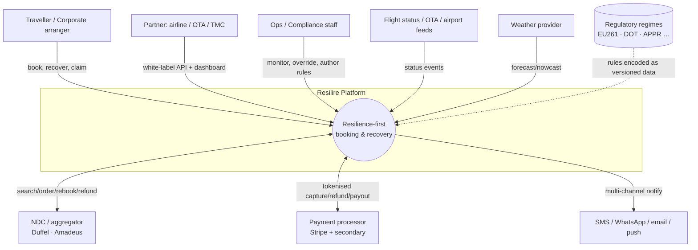

Resilire orchestrates **on top of** carrier systems — it never replaces PSS/DCS (SDD §2.1). The regulatory boundary is dashed: regimes are not an API, they are maintained ruleset data (driver 4, ADR-2).

---

## 3. C4 Level 2 — Container view

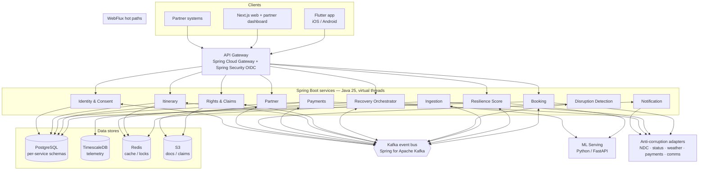

Every service is independently deployable, stateless at the request tier, and owns its data (Section 9). The only synchronous fan-out is gateway→service and service→adapter; everything cross-service is **events over Kafka** (ADR-1).

---

## 4. C4 Level 3 — Component view (the three architecturally significant services)

### 4.1 Disruption Detection (WebFlux, single authoritative state)

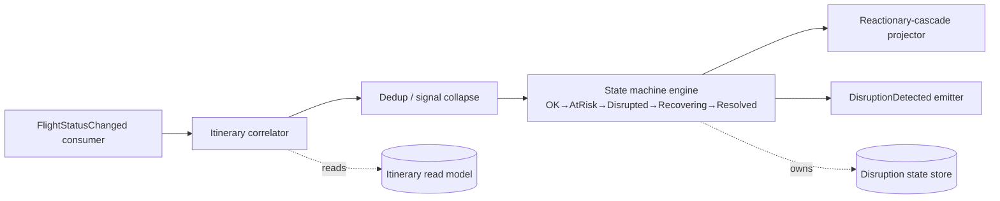

Detection is the **single writer** of disruption state per itinerary; conflicting source signals collapse to one authoritative transition (SDD §5.4). The cascade projector models reactionary delay propagation (primary→knock-on) as derived events, not new ingest.

### 4.2 Recovery Orchestrator (saga, authority-gated)

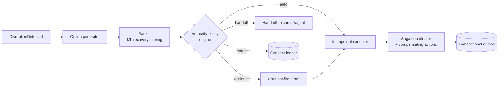

One option-generation path always runs; the **authority policy engine** (Section 10) decides the terminal step. Execution is a saga with compensations and an idempotency key (driver 1, ADR-4).

### 4.3 Rights & Claims Engine (versioned, effective-dated)

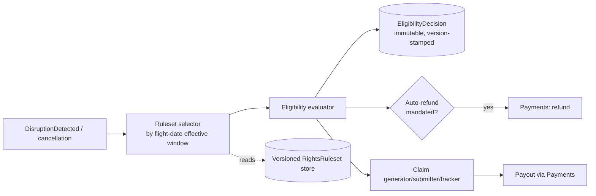

Selection keys on the **flight date's effective window**, never "latest" (SDD §5.1) — this makes the EU261 reform a data rollout, not a redeploy (driver 4).

---

## 5. End-to-end flows (detailed)

### 5.1 Booking with Resilience Score

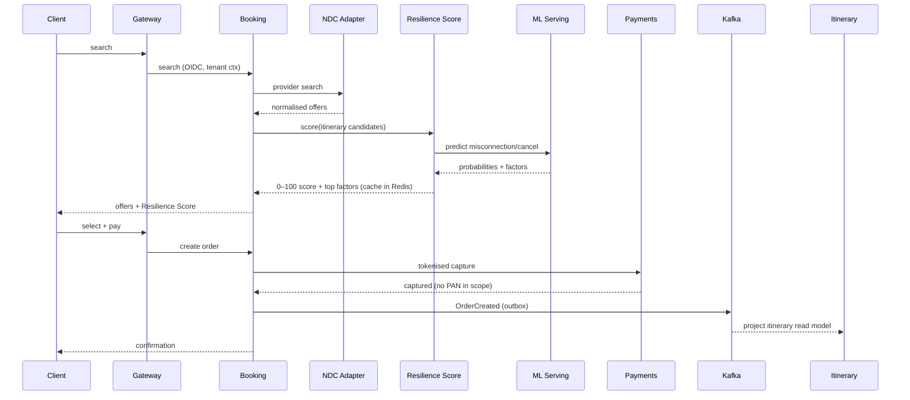

### 5.2 Disruption detection → authority-gated recovery

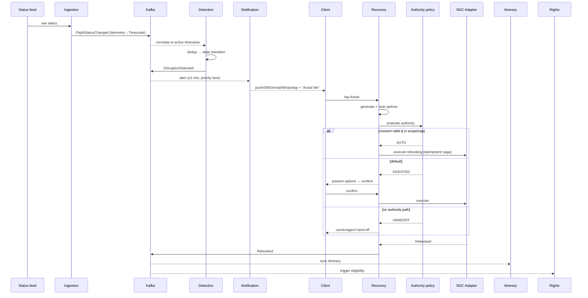

### 5.3 Rights eligibility → claim → payout

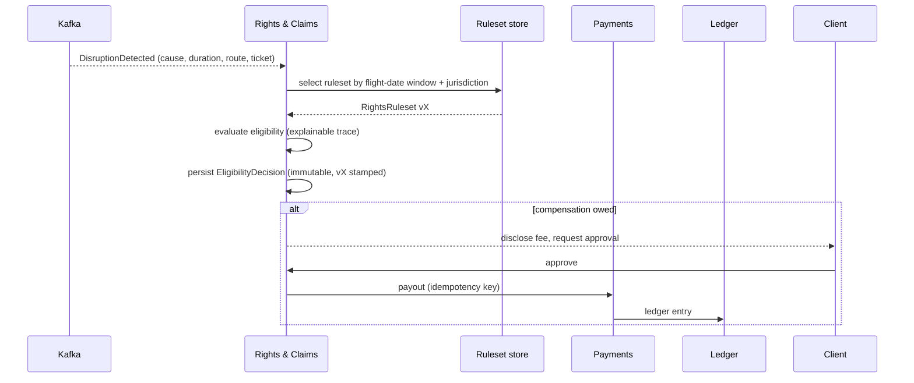

### 5.4 US DOT automatic refund (no user action required)

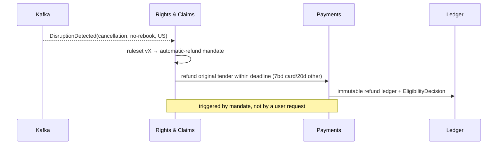

### 5.5 Downstream itinerary sync & reactionary cascade

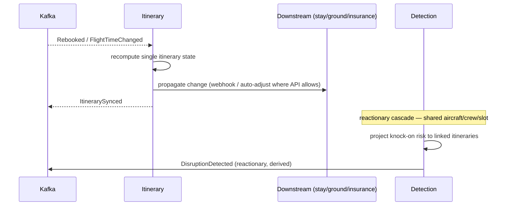

---

## 6. Service catalog

| Service | Sync API (in) | Consumes (Kafka) | Produces (Kafka) | Owns (data) | State | Scaling trigger | Failure mode |
|---|---|---|---|---|---|---|---|
| Booking | search/order/cancel | — | OrderCreated, OrderCancelled | Order/PNR, fare | Stateless | search RPS | Adapter down → degraded search, no order |
| Resilience Score | score(itinerary) | OrderCreated | ScoreComputed | score cache (Redis) | Stateless | score RPS | ML down → stale/last-known + flag (NFR-ACC-1) |
| Ingestion (WebFlux) | — | — | FlightStatusChanged | Telemetry (Timescale) | Stateless | event lag | Feed gap → degraded detection, no data loss |
| Detection (WebFlux) | — | FlightStatusChanged | DisruptionDetected | Disruption state | Stateful (per-itinerary) | partition lag | Replays from Kafka offset |
| Recovery Orchestrator | assist/confirm | DisruptionDetected | Rebooked, RecoveryFailed | Recovery saga state | Stateful (saga) | disruption volume | Saga compensates; idempotent retry |
| Rights & Claims | claim status | DisruptionDetected | EligibilityDetermined, PayoutInitiated | Decisions, claims, rulesets | Stateful | disruption volume | Decision deferred, never guessed |
| Itinerary | get itinerary | OrderCreated, Rebooked, *Changed | ItinerarySynced | Read model (projection) | Read model | read RPS | Serves cached view (NFR-AVL-1) |
| Payments | — (internal) | PayoutInitiated | PaymentSettled | Ledger | Stateful | payout volume | Idempotent; reconcile job |
| Notification | prefs | DisruptionDetected, * | NotificationDelivered | Delivery log | Stateless | alert burst | Channel fallback chain |
| Partner | partner REST/events | * (tenant-filtered) | UsageMetered | Tenant config, metering | Stateless | partner RPS | Per-tenant rate-limit |
| Identity & Consent | auth, consent | — | ConsentChanged | Users, consent ledger | Stateful | login RPS | Append-only ledger; no in-place mutation |

---

## 7. Event architecture (Kafka)

- **Topic taxonomy:** domain-event topics (`flight.status.changed`, `disruption.detected`, `order.created`, `recovery.rebooked`, `rights.eligibility.determined`, `payment.*`, `itinerary.synced`, `consent.changed`). One topic per event type; no shared "firehose".
- **Partitioning key = `itineraryId`** for the disruption/recovery/itinerary stream → preserves per-itinerary ordering (the only ordering that matters). Telemetry keyed by `flightKey`.
- **Schema & evolution:** Avro/Protobuf in a schema registry; **backward-compatible only** (add optional fields, never remove/repurpose). Each event carries `schemaVersion`, `eventId`, `correlationId`, `tenantId`, `occurredAt`.
- **Exactly-once *effect*** (not delivery): transactional outbox on the producing service's DB commit + idempotent consumers keyed by `eventId`/business `idempotencyKey` (driver 1, NFR-REL-1). No dual-write.
- **Replay & recovery:** detection/itinerary projections are rebuildable by replaying from a retained offset. Compaction on state-snapshot topics; long retention on audit-bearing topics (rights/payment) feeding the immutable log.
- **DLQ + poison handling:** per-consumer DLQ with replay tooling; rights/payment events never silently dropped — they page on DLQ.
- **Reactionary cascade** is *derived* events emitted by Detection, never re-ingested raw — prevents feedback loops.

---

## 8. Data architecture

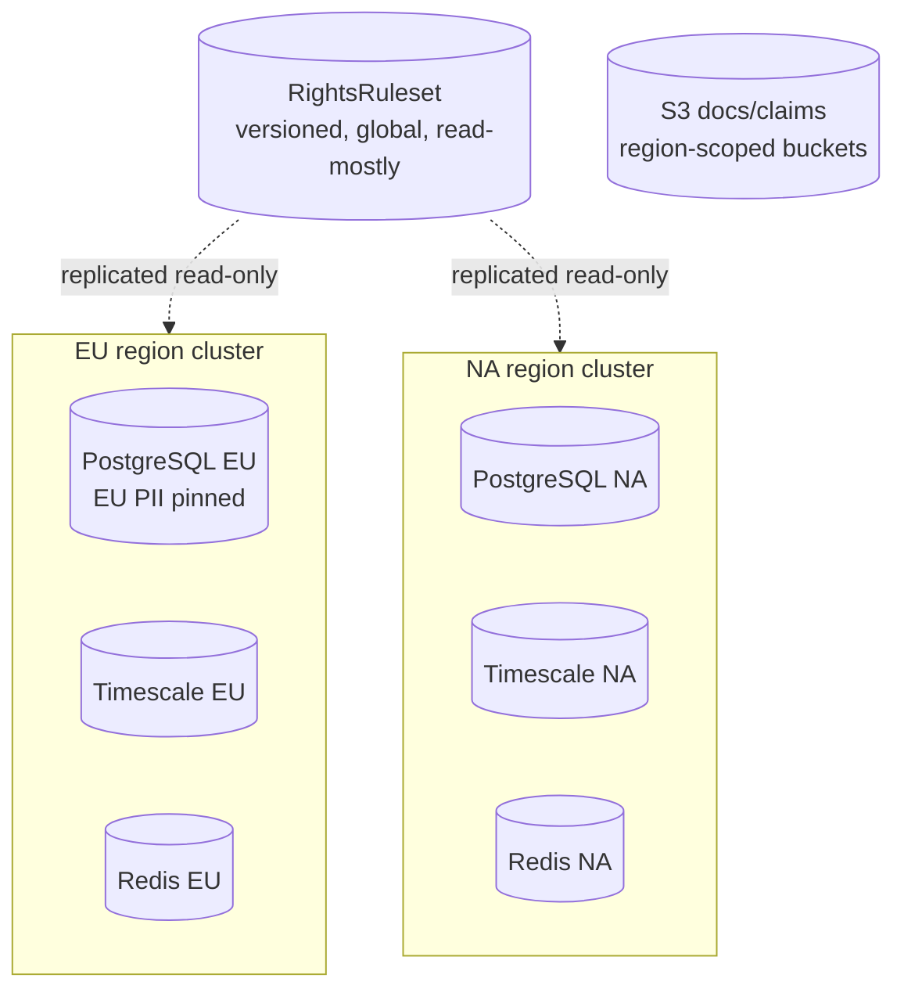

- **Database-per-service** (logical schemas, not a shared DB) — services never reach into each other's tables; integration is events only.
- **CQRS itinerary read model** (ADR-5): write side = order/recovery events; read side = denormalised, Redis-fronted projection giving offline-tolerant, upstream-independent reads (driver 2).
- **Versioned rights ruleset** = `(jurisdiction, version, effective_from, effective_to, rules_json)`, append-only, **never mutated in place**; selection by flight-date effective window. Read-mostly, globally replicated read-only (it's regulation, not PII).
- **Residency partitioning:** EU `User`/PII physically resides in the EU cluster; routing by `residencyRegion` on the tenant/user. Cross-region is operational metadata only, never PII (driver 5, NFR-PRIV-1).
- **Immutability:** `EligibilityDecision`, `Consent`, `PaymentLedger` are append-only with version/actor/timestamp — the compliance audit substrate (driver 3, NFR-COMP-1).
- **Telemetry** in TimescaleDB (status/OTP time-series) feeds the ML feature pipeline; hot path never blocks on it.
- **Retention:** PII honours DSAR erasure ≤30 days (tombstone + crypto-shred); audit/ledger retained per regulatory minimums independent of PII erasure (legal-hold carve-out).

---

## 9. Authority-gated recovery policy engine

The single most commercially load-bearing mechanism (R-1, R-6 in [`SDLC-plan-and-test.md`](./SDLC-plan-and-test.md) §4).

| Input | Source | Effect on decision |
|---|---|---|
| Auto-Recovery consent (scope, spend cap, expiry) | Consent ledger | Required for `AUTO` |
| Partner authority grant (carrier/route/fare class) | Partner tenant config | Widens `AUTO` envelope |
| Disruption + option attributes (carrier, cost delta, reversibility) | Recovery context | Irreversible/over-cap → downgrade |
| Jurisdiction constraints | Rights engine | Legal block → `HANDOFF` |

**Decision = `min(authority granted, action reversibility, scope/cap satisfied)`** → one of `ASSISTED` (default, user confirms), `AUTO` (all gates pass), `HANDOFF` (no programmatic path). The same code path serves all three; **new partner agreements widen the policy data, never the code** (ADR-4). Every decision is logged with the authority basis (audit).

---

## 10. Versioned rules & model lifecycle

- **Rule authoring:** Compliance officer authors/reviews rulesets in a governed workflow (RACI: Compliance = Accountable). Rulesets are data artefacts with effective dates, versioned, peer-reviewed, never hot-edited in prod.
- **Staged rollout:** canary by **jurisdiction then tenant**; effective-date selection means a future-dated ruleset can ship *before* it is legally live and activates automatically on the flight date — decoupling deploy from legal effectivity (handles EU261 trilogue uncertainty).
- **ML pipeline:** offline feature pipeline (Timescale → feature store) → training → model registry/MLflow → versioned FastAPI serving endpoints. Score/recovery models are **language-independent over HTTP/gRPC** (ADR-7) so the Spring core never embeds Python.
- **Degrade-safe:** model unavailable or low-confidence → flag and fall back to last-known/heuristic, never fabricate a score (NFR-ACC-1). Drift monitored; accuracy gate per phase ([`SDLC-plan-and-test.md`](./SDLC-plan-and-test.md) §5).

---

## 11. Integration & anti-corruption layer

```mermaid
flowchart LR
  subgraph CORE[Domain core]
    DM[Domain model]
  end
  subgraph ACL[Anti-corruption adapters]
    NDC[NDC strategy<br/>Duffel | Amadeus | direct]
    STT[Status/weather normaliser]
    PAYA[Payment tokenisation adapter]
    CMA[Comms multi-channel adapter]
  end
  EXT[(Volatile external APIs)]
  DM <--> ACL
  ACL <--> EXT
  ACL -.->|circuit breaker + timeout + retry budget| EXT
```

Each adapter is a pluggable strategy translating vendor models → domain model (ADR-3). Volatile vendor types **never leak past the adapter** (Clean Code boundaries). Every external call has a circuit breaker, timeout, bounded retry, and a defined **degraded mode** (cached read / queued action / hand-off). Contract tests pin vendor behaviour and catch breaking upgrades (R-9).

---

## 12. Cross-cutting architecture

- **Security:** OAuth2/OIDC at Spring Cloud Gateway; tenant + actor claims propagated as signed context; mTLS service-to-service; secrets in managed vault; least-privilege IAM; OWASP ASVS L2. **PCI scope confined to Payments + processor** — every other service handles tokens only (driver 6, NFR-SEC-1/2).
- **Privacy/residency:** region-pinned EU/NA clusters; DSAR export/erasure workflow; consent ledger immutable and append-only (driver 5).
- **Observability:** OpenTelemetry distributed tracing **across the Kafka bus** via propagated `correlationId`; per-itinerary trace stitching; SLO dashboards; MTTD ≤ 5 min (NFR-OBS-1).
- **Resilience patterns:** bulkheads per external dependency, circuit breakers, idempotent consumers, sagas + compensation, degraded mode on every adapter, backpressure on WebFlux ingest, priority lane so disruption alerts bypass general load shedding.
- **Multi-tenancy:** tenant-scoped tokens; per-tenant data partitioning + branding; usage metering on the event stream for billing; per-tenant rate limits prevent noisy-neighbour.

---

## 13. Deployment & infrastructure topology

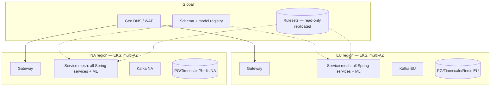

- **EKS, multi-AZ, two regions (EU + NA)**; data residency = region affinity by tenant/user. Kafka is regional (no cross-region PII replication); rulesets/registry are global read-only.
- **Environments:** dev → stage → prod, IaC-managed (Terraform), identical topology scaled down.
- **Progressive delivery:** trunk-based + feature flags; GitHub Actions `build→test→scan→deploy`; canary by jurisdiction/tenant for ruleset/model versions with automated rollback ([`SDLC-plan-and-test.md`](./SDLC-plan-and-test.md) §7).

---

## 14. Scalability, reliability & DR

- **IROPS storm model:** mass events spike disruption volume ~5×. Kafka partitions sized for peak; Detection/Recovery autoscale on consumer lag; **alerts keep a reserved priority lane** so surge never delays the ≤2-min notification SLA (NFR-PERF-1/SCAL-1). Auto-scale to 5× within 5 min.
- **SLOs:** core booking/disruption 99.9% monthly; detection pipeline 99.95% (degraded-mode tolerated, **data loss not**).
- **Failure domains:** AZ loss = transparent (multi-AZ). Region loss = failover for stateless tier; regional data does **not** cross residency boundary — DR is in-region replicas, RPO≈0 for ledger/decisions (synchronous), RTO target minutes for stateless, longer for stateful rebuild via Kafka replay.
- **Recovery:** projections and detection state are reconstructable by replaying retained Kafka offsets — no projection store is a single point of truth.

---

## 15. Architecture Decision Records (continuing from SDD ADR-1–8)

| ADR | Decision | Rationale | Trade-off accepted |
|---|---|---|---|
| ADR-9 | Database-per-service, integration via events only | Independent evolution; no shared-DB coupling | Cross-service queries need read models, not joins |
| ADR-10 | Transactional outbox for all state-changing events | Exactly-once effect without distributed 2PC | Outbox table + relay per service |
| ADR-11 | `itineraryId` as Kafka partition key | Per-itinerary ordering is the only ordering that matters | Hot itineraries can hot-partition (mitigated: ephemeral) |
| ADR-12 | Regional Kafka + global read-only rulesets | Residency: no cross-region PII; rules are non-PII regulation | Two Kafka clusters to operate |
| ADR-13 | Schema-registry, backward-compatible events only | Safe independent deploys across services | Additive-only event evolution discipline |
| ADR-14 | Reserved priority lane for disruption alerts | Surge must not breach the ≤2-min SLA | Capacity reserved (not fully elastic) for that lane |
| ADR-15 | **Microservices from day one** (modular-monolith-first explicitly rejected); 12 Spring Boot 4.0.6 / Java 25 services scaffolded via Spring Initializr, one independent Maven build each | Team decision: own the distributed-systems cost upfront rather than carry a monolith-extraction migration; DB-per-service + event contracts (ADR-9/13) enforced from the first commit | Higher ops/CI surface and local-dev complexity from MVP; mitigated by shared scaffold + the §17 phased rollout (single region, `AUTO` off in Phase 1) |

---

## 16. Traceability — requirement → mechanism

| SRS ref | Architectural mechanism (this doc) |
|---|---|
| FR-1/FR-10 | §5.1 booking+payment flow; PCI-isolated Payments (§12) |
| FR-2 | §4.1 score path; ML lifecycle §10; Redis cache §8 |
| FR-3 | §4.1 detection state machine; §7 event model; §14 surge lane |
| FR-4/FR-8 | §4.2 + §9 authority-gated recovery; saga+outbox |
| FR-5/FR-7 | §4.3 + §10 versioned effective-dated rights engine |
| FR-6 | §5.5 + §8 CQRS itinerary read model & downstream sync |
| FR-9 | §6 Partner service; §12 multi-tenancy/metering |
| FR-11 | §6 Notification; §14 priority lane |
| FR-12 | §12 OIDC/identity; §8 immutable consent ledger |
| NFR-REL/AVL/COMP/MNT/PRIV/SEC/PERF | drivers §1 → mechanisms §7–§14 |

---

## 17. Open architecture questions & evolution

Tracked against the phased roadmap ([`SDLC-plan-and-test.md`](./SDLC-plan-and-test.md) §1):

| Phase | Architectural delta |
|---|---|
| **MVP** | Single-region first; assisted-only recovery (policy engine present, `AUTO` disabled); score on open OTP; outbox + idempotency from day one (cheap later only if built in now) |
| **V1** | Enable `AUTO` path behind partner authority + legal gate; second region for residency; rights engine multi-jurisdiction |
| **V2** | Parametric/insurance fallback service (FR-7); reactionary-cascade projector hardened; multi-modal recovery |
| **Scale** | Partner-network throughput; per-tenant capacity isolation; ruleset governance tooling at scale |

Unresolved (depend on validation gates, not engineering):
1. Pre-partnership rebooking execution — handoff vs limited NDC write (B2B pilot dependent).
2. Separate-ticket protection — parametric vs best-effort rebooking unit economics.
3. ML cold-start accuracy ceiling on open data before partner inventory improves it.
