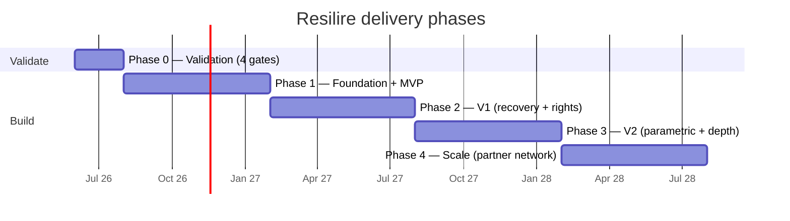
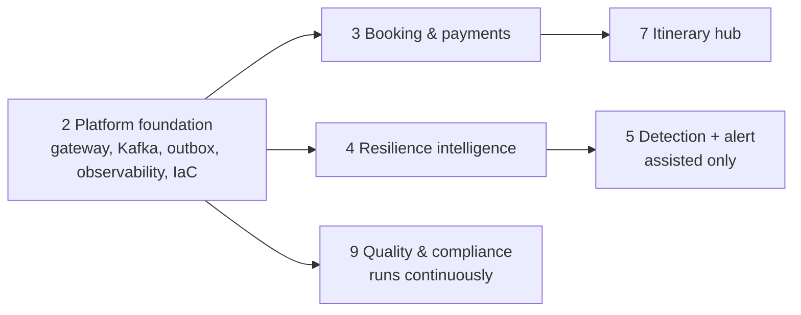

# Development Roadmap — Phased Delivery Plan

**Product:** Disruption-Resilient Flight Booking Platform (*Resilire*)
**Document:** Roadmap v1.0 — consolidated, plannable phasing
**Status:** Planning baseline
**Last updated:** 2026-05-17
**Companion docs:** [`business-case.md`](./business-case.md) (gates) · [`SDLC-plan-and-test.md`](./SDLC-plan-and-test.md) (lifecycle/WBS/RACI/risk) · [`architecture.md`](./architecture.md) (per-phase deltas) · [`SRS.md`](./SRS.md) (FR scope)

> Purpose: a single executable view. It does not replace the other docs — it sequences them. Phase scope comes from SDLC §1, the pre-build gates from business-case §7–8, the architectural posture per phase from architecture.md §17. The value added here is **sequencing, parallel tracks, dependencies, and explicit out-of-scope boundaries** so you can resource it.

---

## 0. The one rule that shapes everything

**Do not start full build (Phase 1) until Phase 0's four gates pass.** The venture is a Conditional GO (business-case §1); the expensive mistake is sinking build capital before validation. Every phase below also has an **exit gate** — a phase is not "done" until its gate is signed, regardless of feature completeness.

---

## 1. Phase map at a glance

| Phase | Window | Objective | Spend posture |
|---|---|---|---|
| **0 Validation** | ~6–8 weeks | Prove the 4 hypotheses cheaply | Minimal — no full build |
| **1 Foundation + MVP** | M0–6 | Bookable product + resilience score + assisted detection | Core build starts |
| **2 V1** | M7–12 | Automated recovery (gated) + rights/claims + partner API | Scale build |
| **3 V2** | M13–18 | Parametric protection + forecasting depth + jurisdiction expansion | Depth build |
| **4 Scale** | M18–24 | Partner network + white-label scale + marketplace | Growth build |

---

## 2. Phase 0 — Validation (gate to build)

**Objective:** answer the four open questions before committing build capital. No production code; spikes only.

| Gate | Pass condition | Owner | Effort |
|---|---|---|---|
| G1 — B2C WTP | ≥500-traveller survey + interviews show a viable paid segment **or** the B2B2C model holds without B2C revenue | Product | Low |
| G2 — Partner authority | ≥1 carrier + ≥1 OTA/TMC sign a pilot LOI | GTM | Low–Med |
| G3 — Tech proof | Resilience-Score AUC ≥ target on **open** OTP data (no partner data) | ML | Low |
| G4 — Legal | Counsel opinion: third-party assisted-rebooking & claims authority workable per target jurisdictions | Legal | Low |

**Parallel:** all four run concurrently — independent owners, no inter-dependency.
**Exit:** re-score the business-case scorecard. **GO** → Phase 1. **G2 or G4 fail** → pivot/stop (not "fix and continue"). G1/G3 weak → narrow scope, re-gate.
**Out of scope:** any service code, infra, or partner integration build.

---

## 3. Phase 1 — Foundation + MVP (M0–6)

**Objective:** a real bookable product that *shows* resilience and *detects* disruption — assisted only.

**Scope (SRS FRs):** FR-1 booking, FR-2 Resilience Score, FR-3 detection+alert, FR-6 itinerary hub, FR-10 payments, FR-11 notifications, FR-12 identity.

**Architectural posture (architecture.md §17):**
- Single region first.
- Authority policy engine **present but `AUTO` disabled** — assisted-with-consent only.
- **Transactional outbox + idempotency from day one** — retrofitting these later is far more expensive than building them in (ADR-10); this is the one non-negotiable foundation investment.
- Score trained on open OTP data (no partner inventory yet).

**Workstream sequencing** (WBS from SDLC §2):

- **Critical path:** Platform foundation → Booking → Itinerary. Nothing useful ships until foundation (gateway/Kafka/outbox/identity) is up.
- **Parallel once foundation lands:** Resilience intelligence (track 4) and Booking (track 3) proceed independently; Detection (track 5, assisted scope) starts after the score/feature pipeline exists.
- **Continuous:** Quality & compliance (track 9) and observability are not a phase-end activity — they run every sprint.

**Exit gate:** Score model ≥ target AUC on open data · PCI/GDPR review passed · **1 B2B LOI** (carries over from G2).
**Out of scope (do NOT build yet):** automated recovery execution, rights/claims engine, partner API/dashboard, second region, parametric products, downstream auto-sync.

---

## 4. Phase 2 — V1 (M7–12)

**Objective:** turn detection into action and compliance into a product.

**Scope:** FR-4 recovery (assisted→automated, opt-in), FR-5 rights & claims, FR-6 downstream sync, FR-8 prefs/consent, FR-9 partner API + white-label dashboard.

**Architectural posture:**
- Enable the `AUTO` recovery path **behind the partner-authority + legal gate** — the code path already exists from Phase 1; this phase widens the *policy data*, not a rewrite (ADR-4).
- Stand up the **second region** for residency (EU/NA split).
- Rights engine goes multi-jurisdiction with the versioned, effective-dated ruleset (the EU261-trilogue hedge — future-dated rulesets ship before they're legally live).

**Dependencies / sequencing:**
- Rights engine depends on the versioned-ruleset store + governance workflow existing first → build ruleset infrastructure before eligibility logic.
- `AUTO` recovery depends on **G4 legal opinion** *and* **G2 signed pilot** — do not enable without both; ASSISTED remains the fallback.
- Partner API depends on tenant isolation + metering (WBS 8) being in place.

**Exit gate:** Legal opinion on rebooking/claims authority signed · **1 carrier + 1 OTA/TMC pilot live**.
**Out of scope:** parametric/insurance products, multi-modal recovery, jurisdiction expansion beyond launch set, marketplace.

---

## 5. Phase 3 — V2 (M13–18)

**Objective:** close the hardest gaps — unprotected travellers and prediction depth.

**Scope:** FR-7 separate-ticket detection + parametric fallback; AI forecasting depth; multi-modal recovery; jurisdiction expansion.

**Architectural posture:** new parametric/insurance fallback service; reactionary-cascade projector hardened; multi-modal recovery options.

**Exit gate:** Multi-jurisdiction rules audited · parametric unit economics validated (this gate is partly *commercial*, not just technical — R-7).
**Out of scope:** anything not validated in Phase 3's economics gate; partner-network scale features.

---

## 6. Phase 4 — Scale (M18–24)

**Objective:** make it a network business.

**Scope:** partner network growth, white-label scale, ancillary marketplace, per-tenant capacity isolation, ruleset governance tooling at scale.

**Exit gate:** Series-A operational metrics met.

---

## 7. Cross-phase dependency rules (the sequencing constraints)

These are the "if you skip this, you pay 10× later" items:

1. **Outbox + idempotency in Phase 1, always.** Retrofitting exactly-once-effect into a live money system is a rebuild, not a patch.
2. **Authority policy engine ships in Phase 1 even though `AUTO` is off.** Phase 2 flips data/config, not architecture — only true if the engine exists from the start.
3. **Versioned-ruleset store before any rights logic (Phase 2).** Eligibility code written against a non-versioned store cannot be made effective-date-correct later.
4. **Second region before scaling EU traffic (Phase 2).** Residency cannot be bolted on after PII has accumulated single-region.
5. **Compliance/observability are continuous, not phase-gated.** Every phase exit includes a security + privacy + (where applicable) accuracy sign-off (SDLC §5, §8).

---

## 8. How to resource it (team-shape emphasis by phase)

| Phase | Heaviest tracks | Lightest |
|---|---|---|
| 0 | Product, GTM, Legal, ML (spikes) | Eng |
| 1 | Platform Eng, Booking Eng, ML | Legal |
| 2 | Eng (recovery+rights), Compliance, Partner/GTM | ML (steady) |
| 3 | ML (forecasting), Product (parametric economics), Compliance | Platform |
| 4 | Partner/GTM, Platform (scale) | — |

**Re-decision checkpoints:** end of Phase 0 (build/no-build re-score) and end of Phase 2 (the pilot must prove the B2B2C thesis before Phase 3/4 growth spend). Treat these as real go/no-go, not formalities.

---

## 9. Traceability

- Phase scope ↔ FRs: [`SRS.md`](./SRS.md) §3 + [`SDLC-plan-and-test.md`](./SDLC-plan-and-test.md) §6 (RTM).
- Gates ↔ risks: G1–G4 and exit gates map to R-1…R-9 in [`SDLC-plan-and-test.md`](./SDLC-plan-and-test.md) §4.
- Architectural deltas per phase: [`architecture.md`](./architecture.md) §17.
- Investment logic: [`business-case.md`](./business-case.md) §7–9.
